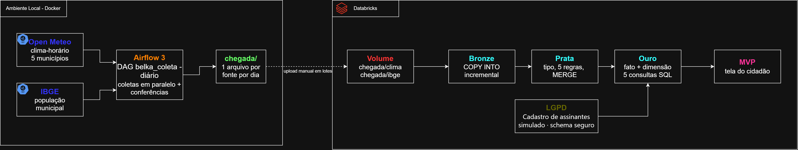

# Belka · Big Data Architecture & Data Integration

**Olhar longe. Proteger perto.**

A Belka é uma startup CitizenTech de alerta antecipado que transforma dados ambientais em alertas claros, acessíveis e acionáveis contra enchentes, deslizamentos, incêndios e ondas de calor. Este repositório contém o componente **Dados** do MVP: o pipeline que coleta clima e população, trata os dados em camadas Bronze, Prata e Ouro no Databricks e entrega ao MVP o nível de atenção de cada município.

> Os níveis calculados são **indicadores experimentais** e não substituem os alertas oficiais da Defesa Civil.

## Integrantes

| Nome completo | RM |
|---|---|
| Fernanda Kaory Saito | 551104 |
| João Pedro Borsato | 550294 |
| Maria Fernanda Camargo | 97956 |
| Pedro Lucas Nunes | 550366 |
| Vinícius Bernardino | 97888 |

## Perguntas que o MVP responde

Cada pergunta é respondida por uma consulta SQL sobre a camada Ouro (notebook `ouro_belka`).

| # | Pergunta | Para quem |
|---|---|---|
| 1 | Como está o meu município hoje? | Cidadão |
| 2 | Quais municípios passaram mais tempo em alerta? | Defesa Civil |
| 3 | Qual sinal chegou mais perto do perigo em cada município? | Cidadão |
| 4 | Em que horário do dia o risco é maior? | Cidadão |
| 5 | Quantas pessoas vivem onde o nível chegou a Prepare-se ou Aja agora? **(impacto)** | Defesa Civil |

## Arquitetura

## Arquitetura

<p align="center">
  
</p>

<p align="center">
  <em>Arquitetura do pipeline de dados Belka:
  Airflow, Databricks e integração com o MVP.</em>
</p>

| Camada | Tabelas | O que faz |
|---|---|---|
| Bronze | `bronze_clima`, `bronze_populacao` | Dado bruto, carga incremental com COPY INTO, `arquivo_origem` e `carregado_em` |
| Prata | `prata_clima_hora`, `prata_populacao`, `prata_qualidade`, quarentenas | Tipos e nulos tratados, 5 regras de qualidade com contagem, MERGE pela chave |
| Ouro | `ouro_fato_risco_hora`, `ouro_dim_municipio`, `ouro_dim_tempo`, `ouro_dim_nivel_risco` | Modelo estrela e 5 consultas SQL |
| LGPD | `belka_seguro.prata_assinante` → `ouro_dim_assinante`, `ouro_vw_assinantes_municipio` | Cadastro **simulado**, hash com salt, máscaras e supressão de grupos < 5 |

### Fontes

| Fonte | Endpoint | Formato | Frequência |
|---|---|---|---|
| Open-Meteo | `api.open-meteo.com/v1/forecast` | JSON → JSON Lines | Diária: 5 municípios × 24 horas |
| IBGE | `servicodados.ibge.gov.br/api/v3/agregados/6579` (variável 9324) | JSON → JSON Lines | Diária: população estimada mais recente |

Nenhuma das fontes exige chave de API.

## Estrutura do repositório

```
dags/          DAG belka_coleta do Airflow
databricks/    notebooks das camadas, na ordem: bronze, prata, ouro, lgpd
amostras/      um exemplo de resposta de cada fonte
config/        variaveis.json (Variable belka_municipios)
scripts/       testar_fontes.py
mvp/           index.html e belka_mvp.json
docker-compose.yaml · 
.env
```

## Como reproduzir

### 1. Testar as fontes

```bash
pip install requests
python scripts/testar_fontes.py      # grava as respostas em amostras/
```

### 2. Subir o Airflow 3

```bash
cp .env.example .env                 # preencha as senhas e a AIRFLOW_FERNET_KEY no .env (nunca versionado)
docker compose up -d
```

- Interface: http://localhost:8080
- O serviço `airflow-init` migra o banco e importa a Variable `belka_municipios` a partir de `config/variaveis.json`.
- Ative o DAG `belka_coleta`. Com `catchup=True`, o Airflow executa um dia por vez desde 25/10/2026 e grava os arquivos em `chegada/clima/` e `chegada/ibge/`.

### 3. Enviar os arquivos ao Databricks (Free Edition)

1. No Catalog Explorer, crie o schema `workspace.belka` e o Volume `workspace.belka.chegada` (o notebook da Bronze também cria, se não existirem).
2. Envie pela interface, em **dois lotes de dias diferentes**, os arquivos de `chegada/clima/` para `/Volumes/workspace/belka/chegada/clima/` e os de `chegada/ibge/` para `/Volumes/workspace/belka/chegada/ibge/`.

### 4. Executar os notebooks, nesta ordem

| Ordem | Notebook | Resultado |
|---|---|---|
| 1 | `bronze_belka` | Carga incremental; execute após cada lote e uma vez mais para comprovar que nada duplica |
| 2 | `prata_belka` | Prata, contagem das regras R1 a R5 e MERGE |
| 3 | `ouro_belka` | Modelo estrela e as 5 consultas SQL |
| 4 | `lgpd_belka` | Cadastro simulado protegido e view agregada |

## Segurança e LGPD

- Nenhuma chave, senha ou dado pessoal real no repositório. Senhas do ambiente ficam no `.env` local.
- O cadastro de assinantes é **simulado** (DDD 00, domínio `exemplo.com`, CEP 00xxx).
- O salt do hash fica em `workspace.belka_seguro.config_hash` e nunca é exibido.
- O MVP consome apenas a view agregada `ouro_vw_assinantes_municipio`.

## Fontes e licenças

- Open-Meteo, licença CC BY 4.0
- IBGE, API de serviços de dados, agregado 6579, variável 9324
